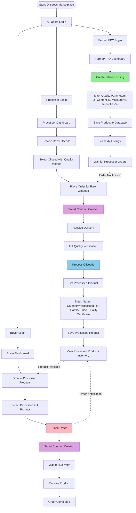

# Oilseeds Marketplace Workflow

## Complete Workflow Diagram

```mermaid
sequenceDiagram
    actor Farmer as Farmer/FPO
    actor Processor as Processor
    actor Buyer as Buyer
    participant FE as Frontend
    participant API as Backend API
    participant Auth as Auth Service
    participant ProdDB as Products DB
    participant OrderDB as Orders DB
    participant ContractDB as Smart Contracts DB
    participant IoT as IoT Quality Sensors

    %% ========== LOGIN PHASE ==========
    Note over Farmer,Buyer: Phase 1: User Authentication
    Farmer->>FE: Login (email, password, role='farmer'/'fpo')
    FE->>API: POST /api/auth/login
    API->>Auth: Verify credentials
    Auth-->>API: JWT token + user profile
    API-->>FE: {token, user: {id, role, name}}
    FE-->>Farmer: Dashboard (Farmer/FPO view)

    Processor->>FE: Login (email, password, role='processor')
    FE->>API: POST /api/auth/login
    API->>Auth: Verify credentials
    Auth-->>API: JWT token + user profile
    API-->>FE: {token, user: {id, role, name}}
    FE-->>Processor: Dashboard (Processor view)

    Buyer->>FE: Login (email, password, role='buyer')
    FE->>API: POST /api/auth/login
    API->>Auth: Verify credentials
    Auth-->>API: JWT token + user profile
    API-->>FE: {token, user: {id, role, name}}
    FE-->>Buyer: Dashboard (Buyer view)

    %% ========== FARMER/FPO LISTING OILSEEDS ==========
    Note over Farmer,ProdDB: Phase 2: Farmer/FPO Lists Oilseeds with Quality
    Farmer->>FE: Navigate to "List Product" / "My Listings"
    FE->>API: GET /api/products/seller/my-products (Bearer token)
    API->>ProdDB: find({seller_id: farmer_id})
    ProdDB-->>API: existing products
    API-->>FE: products list
    FE-->>Farmer: Show existing listings

    Farmer->>FE: Create new oilseed listing
    FE->>Farmer: Form: name, category='oilseeds', quantity, price, location, upload image
    Farmer->>FE: Enter quality parameters: Oil Content %, Moisture %, Impurities %
    FE->>API: POST /api/products (Bearer token)
    Note over API: Body: {name: "Soybean", category: "oilseeds",<br/>quantity: 1000, price: 50, unit: "kg",<br/>location: "Maharashtra", image_url,<br/>quality_notes: {oil_content: 20, moisture: 12, impurities: 5}}
    API->>ProdDB: create({seller_id: farmer_id, name, category,<br/>quantity, price, location, image_url,<br/>status: 'available', quality_metadata})
    ProdDB-->>API: product document
    API-->>FE: {message: "Product listed", product}
    FE-->>Farmer: Success: "Oilseeds listed successfully"

    %% ========== PROCESSOR VIEWS & PROCESSES ==========
    Note over Processor,ProdDB: Phase 3: Processor Views Raw Oilseeds & Processes
    Processor->>FE: Browse marketplace for raw oilseeds
    FE->>API: GET /api/products?category=oilseeds&status=available
    API->>ProdDB: find({category: 'oilseeds', status: 'available'})
    ProdDB-->>API: oilseeds listings with quality data
    API-->>FE: products array
    FE-->>Processor: Display oilseeds with quality metrics (OC%, M%, IM%)

    Processor->>FE: Select oilseed to process
    FE->>API: GET /api/products/:id
    API->>ProdDB: findById(product_id)
    ProdDB-->>API: product details + quality parameters
    API-->>FE: full product info
    FE-->>Processor: View details: quality, quantity, price, seller info

    Processor->>FE: Place order for raw oilseeds (to process)
    FE->>API: POST /api/orders (Bearer token)
    Note over API: Body: {product_id, seller_id, quantity,<br/>total_price, payment_method,<br/>delivery_info, buyer_wallet, seller_wallet}
    API->>OrderDB: create({buyer_id: processor_id, seller_id: farmer_id,<br/>product_id, quantity, total_price,<br/>status: 'pending', ...})
    OrderDB-->>API: order document

    Note over API,ContractDB: Auto-create Smart Contract
    API->>ContractDB: createContract({order_id, buyer_id: processor_id,<br/>seller_id: farmer_id, product_name,<br/>quantity, agreed_quality_grade: 'A',<br/>base_price, buyer_wallet, seller_wallet})
    ContractDB-->>API: smart contract with blockchain_hash
    API->>OrderDB: update({smart_contract_id, blockchain_hash})
    OrderDB-->>API: updated order
    API-->>FE: {message: "Order created", order, contract}
    FE-->>Processor: "Order placed, contract created"

    Note over Processor,OrderDB: Delivery & Quality Verification
    Farmer->>FE: Mark order as "in-transit" / "delivered"
    FE->>API: PUT /api/orders/:id/status {status: 'delivered'}
    API->>OrderDB: update({status: 'delivered'})
    OrderDB-->>API: updated order
    API-->>FE: order updated

    Processor->>FE: Finalize delivery with IoT quality measurement
    IoT->>FE: Sensor data: {oil_content: 19.5%, moisture: 13%,<br/>impurities: 6%, temperature, purity}
    FE->>API: POST /api/contracts/orders/:orderId/finalize
    Note over API: Body: {measured_quality_grade: 'B',<br/>iot_data: {oil_content, moisture, impurities, ...}}
    API->>ContractDB: getContractByOrderId(orderId)
    ContractDB-->>API: contract
    API->>ContractDB: finalizeDelivery(contract_id, measured_grade, iot_data)
    Note over ContractDB: Calculate: price_adjustment based on<br/>agreed_grade vs measured_grade,<br/>update final_amount
    ContractDB-->>API: updated contract with final_amount, price_adjustment
    API->>OrderDB: update({status: 'delivered', order_notes: quality_data})
    OrderDB-->>API: saved order
    API-->>FE: {final_amount, price_adjustment, iot_data}
    FE-->>Processor: "Delivery finalized, price adjusted based on quality"

    %% ========== PROCESSOR LISTS PROCESSED PRODUCT ==========
    Note over Processor,ProdDB: Phase 4: Processor Lists Processed Product
    Processor->>FE: Navigate to "List Processed Product"
    FE->>Processor: Form: processed product details
    Processor->>FE: Enter: name="Refined Soybean Oil", category="processed_oil",<br/>quantity: 200, price: 120, unit: "liters",<br/>source_order_id (optional), quality_certificate
    FE->>API: POST /api/products (Bearer token)
    Note over API: Body: {name: "Refined Soybean Oil",<br/>category: "processed_oil", quantity: 200,<br/>price: 120, unit: "liters",<br/>seller_id: processor_id,<br/>source_product_id, quality_certificate_url}
    API->>ProdDB: create({seller_id: processor_id, name, category,<br/>quantity, price, status: 'available',<br/>source_order_id, quality_certificate})
    ProdDB-->>API: processed product document
    API-->>FE: {message: "Processed product listed", product}
    FE-->>Processor: "Processed product listed successfully"

    Processor->>FE: View my processed products
    FE->>API: GET /api/products/seller/my-products
    API->>ProdDB: find({seller_id: processor_id, category: 'processed_oil'})
    ProdDB-->>API: processed products
    API-->>FE: products list
    FE-->>Processor: Show processed products inventory

    %% ========== BUYER PURCHASES ==========
    Note over Buyer,OrderDB: Phase 5: Buyer Purchases Processed Products
    Buyer->>FE: Browse processed products / marketplace
    FE->>API: GET /api/products?category=processed_oil&status=available
    API->>ProdDB: find({category: 'processed_oil', status: 'available'})
    ProdDB-->>API: processed products from processors
    API-->>FE: products array
    FE-->>Buyer: Display processed oils with prices, quantities, seller info

    Buyer->>FE: Select processed product to buy
    FE->>API: GET /api/products/:id
    API->>ProdDB: findById(product_id)
    ProdDB-->>API: product details
    API-->>FE: full product info
    FE-->>Buyer: View: name, price, quantity available, processor details

    Buyer->>FE: Add to cart / Place order
    FE->>Buyer: Form: quantity, delivery address, payment method
    Buyer->>FE: Submit order
    FE->>API: POST /api/orders (Bearer token)
    Note over API: Body: {product_id, seller_id: processor_id,<br/>quantity, total_price, payment_method,<br/>delivery_info: {fullName, address, city, state, pincode},<br/>buyer_wallet, seller_wallet}
    API->>OrderDB: create({buyer_id: buyer_id, seller_id: processor_id,<br/>product_id, quantity, total_price,<br/>status: 'pending', delivery_info, ...})
    OrderDB-->>API: order document

    Note over API,ContractDB: Auto-create Smart Contract for Buyer-Processor
    API->>ContractDB: createContract({order_id, buyer_id: buyer_id,<br/>seller_id: processor_id, product_name,<br/>quantity, agreed_quality_grade: 'A',<br/>base_price, buyer_wallet, seller_wallet})
    ContractDB-->>API: smart contract with blockchain_hash
    API->>OrderDB: update({smart_contract_id, blockchain_hash})
    OrderDB-->>API: updated order
    API-->>FE: {message: "Order created", order, contract}
    FE-->>Buyer: "Order placed successfully"

    Note over Buyer,OrderDB: Order Fulfillment
    Processor->>FE: View orders (seller-orders)
    FE->>API: GET /api/orders/seller-orders
    API->>OrderDB: find({seller_id: processor_id})
    OrderDB-->>API: orders
    API-->>FE: orders list
    FE-->>Processor: Show buyer orders

    Processor->>FE: Update order status: processing -> in-transit -> delivered
    FE->>API: PUT /api/orders/:id/status {status: 'delivered'}
    API->>OrderDB: update({status: 'delivered'})
    OrderDB-->>API: updated order
    API-->>FE: order updated
    FE-->>Processor: "Order marked as delivered"

    Buyer->>FE: View my orders
    FE->>API: GET /api/orders/my-orders
    API->>OrderDB: find({buyer_id: buyer_id})
    OrderDB-->>API: orders
    API-->>FE: orders list
    FE-->>Buyer: Show purchase history with status

    Note over Buyer,ContractDB: Optional: Quality verification on delivery
    IoT->>FE: Final quality check (if applicable)
    FE->>API: POST /api/contracts/orders/:orderId/finalize
    API->>ContractDB: finalizeDelivery(...)
    ContractDB-->>API: final_amount, price_adjustment
    API-->>FE: settlement complete
    FE-->>Buyer: "Order completed, payment settled"
```

## Simplified Flowchart Version

## Key API Endpoints Used

### Authentication
- `POST /api/auth/login` - All users login
- `GET /api/auth/me` - Get current user

### Products (Farmer/FPO & Processor)
- `POST /api/products` - Create listing (oilseeds or processed products)
- `GET /api/products` - Browse marketplace
- `GET /api/products/seller/my-products` - View own listings
- `GET /api/products/:id` - View product details

### Orders
- `POST /api/orders` - Place order (Processor buys from Farmer, Buyer buys from Processor)
- `GET /api/orders/my-orders` - View own orders (as buyer)
- `GET /api/orders/seller-orders` - View orders (as seller)
- `PUT /api/orders/:id/status` - Update order status

### Smart Contracts
- Auto-created on order creation
- `POST /api/contracts/orders/:orderId/finalize` - Finalize with IoT quality data
- `GET /api/contracts/orders/:orderId/contract` - View contract details

